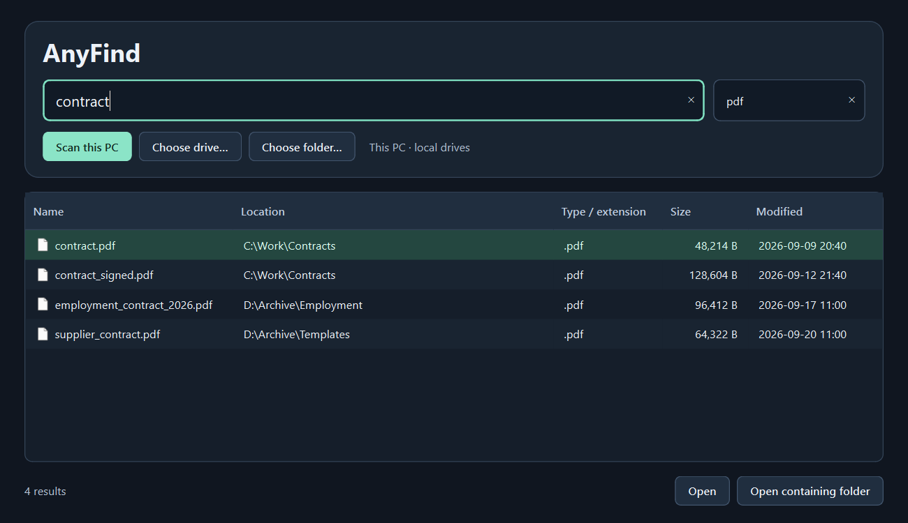

# AnyFind

AnyFind is a Windows desktop app for finding files and folders by name or extension. It runs offline and gives exact filename matches priority over partial matches.



## Run from source

Use Windows and Python 3.12 or later. From the project directory in PowerShell, run:

```powershell
py -3.12 -m venv .venv
.\.venv\Scripts\python.exe -m pip install -r requirements.txt
.\.venv\Scripts\python.exe -m anyfind
```

## Search

- **Scan this PC** searches all available fixed and removable local drives with drive letters.
- **Choose drive** searches one local drive. **Choose folder** searches one folder and its descendants.
- Type a filename, part of a name, or a folder name. Enter an extension such as `pdf` or `.pdf` to narrow the results.
- Double-click a result to open it, or select it and click **Open containing folder** to open its parent in File Explorer.

AnyFind reads file and folder metadata after you choose a scope. The first search waits for the scan to finish. Typing reuses the in-memory snapshot, and rescanning the selected scope picks up changes on disk. Access is limited to the current Windows account. AnyFind reports read errors and skips reparse points, including junctions and symbolic links, to avoid following links outside the scan scope.

## Implementation and verification

The PySide6 window delegates scanning and searching to a single background worker. The scanner uses `os.scandir` to collect metadata. Search ranks full names, names without extensions, prefixes, and substrings in that order, with case-insensitive comparisons. It counts all matches and keeps only the best 250 for display.

```powershell
.\.venv\Scripts\python.exe -m unittest discover -s tests -v
```

The desktop smoke check used temporary directories to exercise all three scope controls, multi-root search, metadata, empty and error states, and the paths passed to Windows for open actions. Whole-PC scan duration and memory use depend on the number of entries and the storage device. Full-drive performance has yet to be benchmarked.

## Roadmap

1. **Working desktop search** — whole-PC, drive, and folder scans, live filename and extension filtering, metadata, and open actions.
2. **Persistent local indexing** — save metadata to SQLite, update it incrementally, support exclusions, and show scan progress while keeping search available.
3. **Smarter search** — rank typo-tolerant matches and path or type clues, then evaluate local document text extraction and multilingual terms for description-based queries.
4. **File interaction** — reveal a file in Explorer, copy paths and names, preview supported formats, sort, add keyboard shortcuts, and keep recent searches.
5. **Reliability and packaging** — benchmark large directories, test indexing and shutdown, and package a Windows executable with PyInstaller.
